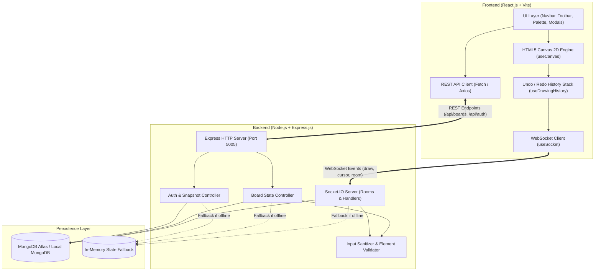

# CollabBoard — Real-Time Collaborative Whiteboard

A modern, high-performance **MERN Stack** (MongoDB, Express.js, React.js, Node.js) web application powered by **Socket.IO** for live multi-user drawing, instant shape tools, text insertion, image uploads, dark mode, personal snapshots, and real-time cursor presence.

---

## 1. Abstract

In distributed engineering teams and educational environments, visual communication is essential for ideation, system design, and collaborative problem-solving. **CollabBoard** is an interactive, browser-based collaborative whiteboard that allows multiple participants to sketch, annotate, upload reference diagrams, and place geometric shapes simultaneously. Drawing operations and pointer movements are transmitted across clients via low-latency WebSockets using Socket.IO. The application features server-authoritative room state synchronization, local in-memory fallback with MongoDB persistence, personal version snapshots, dark mode, image manipulation, and local `.board` file export/import.

---

## 2. Problem Statement

Traditional digital whiteboard applications often suffer from high latency, restrictive paywalls, complex mandatory account creation, or bloated client bundles. College students and project teams require a lightweight, zero-configuration solution that enables instant multi-peer brainstorming with zero friction, support for dark/light themes, offline or file-based snapshots, and clear separation of active room state from persisted storage.

---

## 3. Objectives

- **Sub-millisecond Real-Time Sync:** Broadcast drawing strokes, shapes, and ephemeral cursors across all connected room participants using Socket.IO rooms.
- **Rich Vector & Bitmap Canvas Engine:** Provide high-precision HTML5 Canvas rendering supporting pen/freehand, eraser, lines, rectangles, circles, text, and image uploads.
- **Dark & Light Mode Canvas:** Offer seamless dark-mode workspace (`#111217`) with vibrant strokes and light-mode workspace with charcoal strokes.
- **User Account & Personal Version Snapshots:** Allow users to register/login with email, capture immutable version snapshots of their boards, reload past versions at any time, and export physical `.board` JSON files.
- **Resilient Dual Storage Architecture:** Utilize Mongoose models for permanent MongoDB persistence with an automatic, zero-crash in-memory fallback when MongoDB is offline.
- **College-Ready Viva Presentation:** Clean, modular, well-documented architecture adhering to academic and engineering best practices.

---

## 4. System Architecture



---

## 5. Technology Stack

### Frontend
- **Framework:** React.js 18 with Vite
- **Language:** JavaScript (ES6+ / JSX)
- **Styling:** Vanilla CSS3 with CSS Variables, Design Tokens, and Dark Mode
- **Canvas API:** HTML5 2D Canvas Context with HiDPI / DevicePixelRatio scaling
- **Real-Time Client:** Socket.IO Client (v4.7.5)
- **Routing:** React Router DOM (v6.23)
- **Icons:** Lucide React
- **Notifications:** Lightweight, non-intrusive Toast notification engine with automatic deduplication

### Backend
- **Runtime:** Node.js (v20+ / v24+)
- **Framework:** Express.js (v4.19)
- **Real-Time Engine:** Socket.IO (v4.7.5) with room isolation
- **Database ODM:** Mongoose (v8.3)
- **Security & Validation:** Custom regex sanitization, XSS mitigation, SHA-256 password hashing
- **Environment:** dotenv

### Database
- **Primary:** MongoDB (Atlas Cloud Cluster or Local Service on port 27017)
- **Resilient Fallback:** High-performance In-Memory Map store

---

## 6. Features

| Feature | Description |
| :--- | :--- |
| **Real-Time Collaboration** | Multi-user live drawing synchronized instantly across all connected browser tabs. |
| **Room Isolation** | Dedicated Socket.IO rooms ensuring drawing events never leak between rooms. |
| **Dark / Light Mode** | 1-click toggle between sleek dark mode (`#111217`) and crisp light mode. |
| **Image Uploads** | Upload PNG, JPG, or SVG images directly onto the canvas; auto-scaled and shared in real-time. |
| **Geometric Shapes** | Real-time interactive drag-preview for straight lines, rectangles, and circles/ellipses. |
| **Text Insertion** | Place custom text anywhere on the canvas with adjustable font size and color. |
| **Remote Live Cursors** | Ephemeral, throttled pointer indicators showing teammate names and assigned colors. |
| **Undo / Redo Engine** | Local and synchronized stack-based undo/redo for all operations. |
| **Personal Version Snapshots** | Save point-in-time snapshots to your user profile and reload past versions anytime. |
| **Local File Export / Import** | Download `.board` JSON files and PNG image exports; re-import `.board` files anytime. |
| **Email Accounts & Auth** | Register and sign in with email and password to keep saved boards organized. |
| **Guest / Instant Mode** | Jump into any room with a display name without mandatory login. |

---

## 7. Folder Structure

```
fsd-mini-project/
├── client/                     # Frontend React + Vite Application
│   ├── src/
│   │   ├── components/         # Reusable UI Components
│   │   │   ├── AuthModal.jsx             # Email Login & Registration dialog
│   │   │   ├── BrushSizeControl.jsx      # Stroke thickness selector (2px - 24px)
│   │   │   ├── CollaboratorList.jsx      # Active user avatar stack & counter
│   │   │   ├── ColorPicker.jsx           # Aesthetic palette swatches + eye-dropper
│   │   │   ├── ConfirmDialog.jsx         # Accessible action confirmation modal
│   │   │   ├── Navbar.jsx                # Top bar with status, theme toggle, profile
│   │   │   ├── RemoteCursor.jsx          # Live teammate cursors floating on canvas
│   │   │   ├── SavedSnapshotsModal.jsx   # Personal versions library & file download
│   │   │   ├── ShareDialog.jsx           # 1-click board link & room ID copy
│   │   │   ├── Toast.jsx                 # Deduplicated notification toasts
│   │   │   └── Toolbar.jsx               # Left dock: tools, image upload, snapshot
│   │   ├── hooks/              # Custom React Hooks
│   │   │   ├── useCanvas.js              # Pointer handling, HiDPI resize, preview
│   │   │   ├── useDrawingHistory.js      # Undo/redo stack and element management
│   │   │   └── useSocket.js              # Stable WebSocket listener lifecycle
│   │   ├── pages/              # Route Pages
│   │   │   ├── HomePage.jsx              # Landing hero, create board, join room
│   │   │   └── BoardPage.jsx             # Complete whiteboard workspace
│   │   ├── services/           # Network Services
│   │   │   ├── api.js                    # Fetch wrapper for REST endpoints
│   │   │   └── socket.js                 # Singleton Socket.IO connection manager
│   │   ├── styles/             # Modular CSS
│   │   │   ├── global.css                # CSS variables, typography, buttons
│   │   │   └── whiteboard.css            # Dark mode, workspace layout, docks
│   │   ├── utils/              # Pure Functions
│   │   │   ├── canvasUtils.js            # 2D Canvas rendering & image caching
│   │   │   └── operationUtils.js         # ID generation, throttling, PNG export
│   │   ├── App.jsx             # Route definitions & Toast provider
│   │   └── main.jsx            # React root mount point
│   ├── .env.example            # Client environment sample
│   ├── index.html              # HTML shell with Google Fonts
│   ├── package.json            # Client dependencies
│   └── vite.config.js          # Vite bundler configuration
├── server/                     # Backend Node.js + Express + Socket.IO
│   ├── src/
│   │   ├── config/
│   │   │   └── database.js               # Resilient Mongoose connection module
│   │   ├── controllers/
│   │   │   ├── authController.js         # User registration, login, snapshots
│   │   │   └── boardController.js        # Health check, board CRUD, fallback store
│   │   ├── middleware/
│   │   │   └── errorHandler.js           # Centralized JSON error responder
│   │   ├── models/
│   │   │   ├── User.js                   # User schema with savedBoard snapshots
│   │   │   └── Whiteboard.js             # Room schema with element definitions
│   │   ├── routes/
│   │   │   ├── authRoutes.js             # /api/auth endpoints
│   │   │   └── boardRoutes.js            # /api/health and /api/boards endpoints
│   │   ├── sockets/
│   │   │   └── socketHandlers.js         # Socket.IO room events & debounced save
│   │   ├── utils/
│   │   │   └── validation.js             # Room ID, userName, and element validation
│   │   ├── app.js              # Express app instance and CORS setup
│   │   └── server.js           # HTTP + Socket.IO server startup
│   ├── test/
│   │   └── api.test.js         # Automated test suite using Node.js test runner
│   ├── .env.example            # Server environment sample
│   └── package.json            # Server dependencies & test scripts
├── package.json                # Root orchestration package.json
├── README.md                   # Main documentation
├── PROJECT_REPORT.md           # College project report & design documentation
└── VIVA_QUESTIONS.md           # 20+ Viva exam questions and answers
```

---

## 8. REST API Reference

| Method | Endpoint | Description | Request Body / Query |
| :--- | :--- | :--- | :--- |
| `GET` | `/api/health` | Server uptime & database connection status | None |
| `POST` | `/api/boards` | Create a new whiteboard room | `{ roomId, title, userName }` |
| `GET` | `/api/boards/:id` | Retrieve board elements & metadata | None |
| `PUT` | `/api/boards/:id` | Save board elements directly | `{ elements: [...], title }` |
| `POST` | `/api/auth/register` | Register a new user | `{ email, name, password }` |
| `POST` | `/api/auth/login` | Sign in with email & password | `{ email, password }` |
| `POST` | `/api/auth/snapshots` | Save version snapshot to profile | `{ email, roomId, title, elements }` |
| `GET` | `/api/auth/snapshots` | Retrieve user's saved snapshots | `?email=user@example.com` |
| `DELETE` | `/api/auth/snapshots` | Delete a specific snapshot | `{ email, snapshotId }` |

---

## 9. Socket.IO Events Contract

| Event Name | Direction | Payload | Description |
| :--- | :--- | :--- | :--- |
| `room:join` | Client $\rightarrow$ Server | `{ roomId, userName, userId }` | Joins a whiteboard room |
| `room:state` | Server $\rightarrow$ Client | `{ roomId, elements, users, currentUser }` | Initial room state sent to newly joined user |
| `room:user-joined`| Server $\rightarrow$ Room | `{ user, users }` | Broadcast to peers when a collaborator enters |
| `room:user-left` | Server $\rightarrow$ Room | `{ socketId, userName, users }` | Broadcast when a collaborator disconnects |
| `draw:operation` | Client $\rightarrow$ Server | `Element Object` | Sends committed stroke, shape, or image |
| `draw:remote-operation` | Server $\rightarrow$ Room | `Element Object` | Broadcasts new element to peers |
| `draw:undo` | Client $\rightarrow$ Server | None | Requests room undo |
| `draw:redo` | Client $\rightarrow$ Server | None | Requests room redo |
| `draw:sync-elements` | Server $\rightarrow$ Room | `{ elements: [...] }` | Broadcasts full element array after undo/redo/clear |
| `draw:clear` | Client $\rightarrow$ Server | None | Clears the board and archives to redo stack |
| `cursor:move` | Client $\rightarrow$ Server | `{ x, y }` | Ephemeral cursor movement (throttled) |
| `cursor:remote-move` | Server $\rightarrow$ Room | `{ socketId, userName, color, position }` | Broadcasts peer cursor positions |
| `board:save` | Client $\rightarrow$ Server | `{}` | Requests immediate server-side persistence |
| `board:saved` | Server $\rightarrow$ Room | `{ timestamp }` | Confirms successful save across peers |

---

## 10. Step-by-Step Installation and Setup

### Prerequisites
- **Node.js:** v18.0.0 or higher (v20+ recommended)
- **npm:** v9.0.0 or higher
- Optional: MongoDB local installation or free MongoDB Atlas account

### 1. Clone or Open Project Directory
```powershell
cd "c:\Users\yashb\OneDrive\Desktop\fsd mini project"
```

### 2. Install Dependencies
Run the root helper command to install dependencies across root, server, and client:
```bash
npm run install-all
```
*(Or install individually in each folder: `npm install`, `cd server && npm install`, `cd ../client && npm install`)*

### 3. Configure Environment Variables

**Backend (`server/.env`):**
```env
PORT=5005
CLIENT_URL=http://localhost:5173
MONGODB_URI=mongodb://127.0.0.1:27017/collabboard
NODE_ENV=development
```

**Frontend (`client/.env`):**
```env
# Leave empty to use automatic Vite proxy (recommended for local, LAN, and public tunnel sharing)
VITE_API_URL=
VITE_SOCKET_URL=
```

### 4. Database Setup

- **Option A (Out-of-the-Box Local In-Memory):** No database installation required! If MongoDB is not running, the application will automatically engage its high-performance in-memory store and report its status clearly on the UI health badge.
- **Option B (Local MongoDB):** Start your local MongoDB service:
  ```bash
  net start MongoDB
  ```
- **Option C (MongoDB Atlas Cloud):** Set your Atlas connection string in `server/.env`:
  ```env
  MONGODB_URI=mongodb+srv://<username>:<password>@cluster0.mongodb.net/collabboard?retryWrites=true&w=majority
  ```

### 5. Running the Application

Run both frontend and backend concurrently with a single command from the root directory:
```bash
npm run dev
```

Alternatively, run in separate terminals:
- **Terminal 1 (Backend):**
  ```bash
  npm run server
  ```
  *(Server runs on `http://localhost:5005`)*
- **Terminal 2 (Frontend):**
  ```bash
  npm run client
  ```
  *(Client runs on `http://localhost:5173` or `http://localhost:5174`)*

### 6. Sharing & Deploying With Zero Credentials For Remote Group Testing

CollabBoard is pre-configured with a unified Express server serving the React production bundle, Socket.IO WebSockets, and REST APIs all on a single port (`5005`), making it deployable with zero credentials in seconds:

**Method 1: Cloudflare Quick Tunnels (Zero Credentials, High Speed, Direct HTTPS)**
Run the pre-configured deployment command in your terminal:
```bash
npm run tunnel
```
*(or run `npx cloudflared tunnel --url http://localhost:5005`)*
- Requires **NO accounts**, **NO credit cards**, and **NO login**.
- Generates an instant, production-grade HTTPS URL (e.g., `https://preserve-happened-lite-davidson.trycloudflare.com`).
- Has **NO warning screens or click-throughs** (unlike localtunnel).
- Full WebSocket support across all devices worldwide.

**Method 2: Local Wi-Fi / LAN Sharing (Same network)**
- Look at the terminal output when Vite or the server starts:
  ```
  ➜  Network: http://192.168.0.117:5173/
  ```
- Any teammate or smartphone on the same Wi-Fi can open that URL to draw simultaneously.

**Method 3: localtunnel**
```bash
npx localtunnel --port 5173
```

---

## 11. Testing Multi-User Collaboration (2 Browser Tabs)

1. Open your browser and navigate to `http://localhost:5174/` (or the URL displayed by Vite).
2. Enter your name (e.g., **"Alice"**) and click **"Create Whiteboard"**.
3. Note the Room ID or click **"Share"** $\rightarrow$ **"Copy Link"**.
4. Open a second browser window (or Incognito tab) and paste the link.
5. In the second tab, you can enter a different name (e.g., **"Bob"**).
6. **Live Drawing Test:**
   - Draw with the Pen tool in Tab 1. Watch it appear instantly in Tab 2!
   - Draw a Rectangle or Circle in Tab 2. Watch it commit cleanly in Tab 1!
   - Upload an image in Tab 1. See it render in real-time in Tab 2!
7. **Cursor Presence Test:** Move the mouse cursor across the canvas in Tab 1. In Tab 2, you will see a colored cursor tagged with "Alice" following along.
8. **Dark Mode Test:** Click the Moon icon in the navbar to toggle dark background mode (`#111217`).
9. **Snapshot Test:** Click the "Bookmark" icon on the left toolbar to save a static version snapshot to your profile, accessible from "Saved Versions".

---

## 12. Automated Testing

The backend includes an automated test suite verifying input validation, element sanitization, and REST API health endpoints:
```bash
npm test
```

Test Results:
- `validateRoomId`: Validates alphanumeric room strings, rejects malicious characters
- `sanitizeUserName`: Cleans inputs and strips HTML tags
- `validateElement`: Validates strokes, shapes, and images
- `GET /api/health`: Verifies 200 OK and accurate database status
- `POST /api/boards`: Verifies board initialization

---

## 13. Troubleshooting Common Issues

| Problem | Cause | Solution |
| :--- | :--- | :--- |
| `EADDRINUSE: port 5000` | Port 5000 is occupied by PostgreSQL or AirPlay | Configured to Port 5005 in `.env`. Bind explicitly to `0.0.0.0:5005`. |
| `connect ECONNREFUSED 127.0.0.1:27017` | Local MongoDB is not running | CollabBoard automatically engages its In-Memory Fallback store. Startup is never blocked. |
| Notification spam on join | Unmemoized socket callback dependency | Resolved via `callbacksRef` pattern in `useSocket.js` and toast deduplication. |
| Images don't appear on peers | Cross-origin image drawing | Local images are serialized as Base64 data URLs, enabling peer rendering without third-party hosting. |

---

## 14. Viva Demonstration Script (1-Minute Pitch)

> *"Good morning, professors. Our project is **CollabBoard**, a real-time collaborative whiteboard built on the MERN stack with Socket.IO.
> 
> The core problem we solved is real-time visual synchronization without heavy client overhead. We implemented an HTML5 Canvas engine that treats drawings as structured vector operations rather than screenshot streams. Each stroke, line, rectangle, text box, or image upload has a unique operation ID.
> 
> When a user draws, our custom React hook `useCanvas` renders a live preview, commits the operation, and broadcasts it through a dedicated Socket.IO room. Peers in that room receive and render the element in under 20 milliseconds.
> 
> Additionally, we built a dual-mode canvas with dark background support, user authentication with email login, and personal version snapshots that allow users to freeze and reload static versions of their boards anytime or download them as physical `.board` files. For storage, we implemented Mongoose schemas with an automatic in-memory fallback so the application is completely resilient."*
